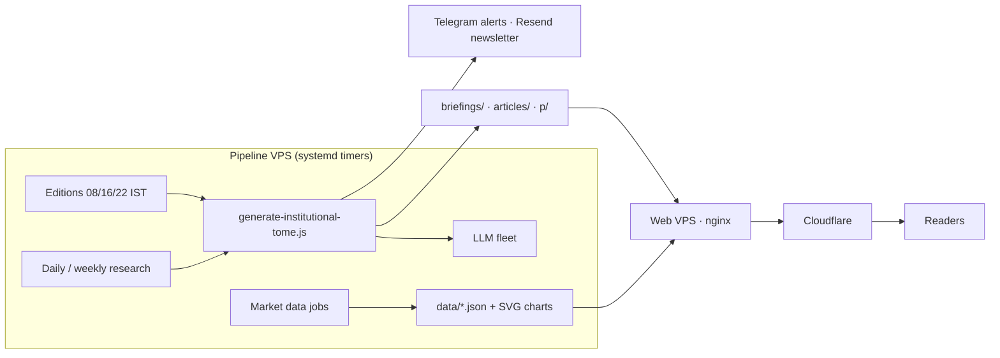

# BlogsPro

Market research for Indian and global markets, written by an LLM pipeline and published at
**[blogspro.in](https://blogspro.in)**. The site carries three market editions a day, daily and weekly research
pieces, and a homepage of live market data: index quotes with intraday charts, top and bottom movers,
the CCIL government bond yield curve, India macro series, and TimesFM forecasts.

> **Repository status.** Production is ahead of `main`. The VPS scheduling, market editions and homepage
> data jobs are deployed from open pull requests (see [Work in open pull requests](#work-in-open-pull-requests)).
> This README describes the system as it runs today and marks what is not merged yet.

---

## How it works



1. **Generation.** systemd timers on the pipeline VPS run `scripts/generate-institutional-tome.js`, which
   gathers live news and market data, sends it through the LLM fleet, and renders static HTML.
2. **Publishing.** Output is written under `/var/www/blogspro` and rsynced to the web VPS. nginx serves it
   behind Cloudflare. Secrets and key files are excluded from every sync.
3. **Homepage data.** Separate jobs refresh `data/*.json` on their own schedules. The Astro homepage in
   `frontend/` fetches those files in the browser, so market data updates without rebuilding the site.
4. **Distribution.** Editions trigger a Telegram alert. Newsletters go out through Resend from a Cloudflare
   Worker.

### Schedules (pipeline VPS)

| Job | When | Output |
| --- | --- | --- |
| Market editions | 08:00, 16:00, 22:00 IST | Morning brief, India close, US open (`briefings/`) |
| Daily research | 00:00 UTC | `articles/` |
| Weekly research | Sunday 01:00 UTC | `articles/` |
| Markets | every 5 min | `data/markets.json`: quotes plus 5-minute intraday points |
| Movers | every 15 min | `data/movers.json`: best/worst 5 per index (Nifty 50, Sensex, Nifty Bank, S&P 500, Nasdaq-100, Nikkei 225) |
| Policy and macro | twice an hour (macro at most every 6 h) | `data/policy.json`: event calendar, MoSPI CPI/WPI/IIP/GDP/unemployment |
| Bonds | hourly | `data/bonds.json`: CCIL G-Sec yield curve |
| Charts | hourly | `data/charts/*.svg`: yield curve, macro and forecast charts |
| Forecasts | 01:30 UTC daily | `data/forecasts.json`: 5-session index and 3-period macro forecasts |

Runs take a shared lock, so generation and data jobs never write at the same time.

### LLM fleet

`scripts/lib/ai-service.js` rotates requests across providers, blacklists failing nodes, and pauses 65 s
when the whole fleet is exhausted. In production the fleet is Groq, Sarvam, Cloudflare Workers AI, and
two Groq bridges. Gemini and Cerebras are switched off in the production configuration. The code still
supports SambaNova, Hugging Face, Mistral and DeepSeek.

Generated copy follows the house style in `SOUL.md`: data first, no promotional language, and **never the
name "BlogsPro" in the body of generated content**.

Model output is rendered by `scripts/lib/templates.js`. PR #537 makes the templates treat it as untrusted:
they escape and sanitize it before rendering HTML.

### Forecasts

Forecasts use Google's **TimesFM** time-series model:

- **Primary:** BigQuery `AI.FORECAST` (TimesFM 2.0). Series are passed only as a query parameter.
- **Fallback:** if BigQuery fails, the same series go to TimesFM 3.0 running on the VPS CPU
  (`scripts/lib/home-forecasts/timesfm_local.py`).

Every section records which engine produced it, and if both engines fail the previous file is kept. In a
170-window backtest on the site's own index series, TimesFM was about 6% less accurate than a
"no change" forecast, and its 80% bands covered 74% of outcomes. Read the forecasts as ranges, not
signals.

---

## Repository layout

```text
scripts/                    pipeline entry points and one-off utilities
scripts/lib/                pipeline core: ai-service, swarm-orchestrator, templates, storage-bridge, news
frontend/                   Astro + Tailwind site (homepage, about, auth pages, post template)
api/                        Cloudflare Worker sources (newsletter, SEO, Sentry webhook, Upstox, Telegram)
workers/                    more Workers (KV cache, Sentry webhook config)
mirofish/                   Python (FastAPI) multi-agent simulation backend
briefings/  articles/  p/   generated content and static post pages
k8s/                        GKE manifests from the earlier deployment (not used in production now)
tests/                      node:test unit tests and Playwright specs
.github/workflows/          CI, Worker deploys, Sentry triage, scheduled syncs
```

Key pipeline files:

| File | Role |
| --- | --- |
| `scripts/generate-institutional-tome.js` | Entry point for every frequency (`--freq=hourly\|daily\|weekly\|monthly`) |
| `scripts/lib/ai-service.js` | Provider rotation, retries, fleet-exhaustion pause |
| `scripts/lib/swarm-orchestrator.js` | Multi-agent drafting and review |
| `scripts/lib/news-orchestrator.js` | Live news gathered before each run |
| `scripts/lib/templates.js`, `briefing-template.js` | HTML rendering |
| `scripts/lib/storage-bridge.js` | Persistence (Firestore, GitHub, local disk) |

---

## Cloudflare Workers

| Worker | Source / config | Purpose |
| --- | --- | --- |
| `blogspro-newsletter` | `api/newsletter-worker.js`, `wrangler.toml` | Newsletter sending through the Resend batch API |
| `blogspro-seo-worker` | `api/seo-worker.js`, `wrangler-seo.toml` | Open Graph and Twitter meta tags for post pages |
| `blogspro-sentry-webhook` | `workers/sentry/wrangler.toml` | Sentry events → Telegram alerts and GitHub issues |
| `blogspro-upstox` | `api/upstox-worker.js` | Read-only market data proxy |

Each Worker deploys from its own GitHub Actions workflow when its source changes.

---

## Development

Requirements: Node.js 20+, npm. Wrangler is only needed to deploy Workers.

```bash
npm install
npm run ecc:install-hooks          # pre-commit / pre-push checks (secret scan, quality gate)

# Site
cd frontend && npm install && npm run dev

# One pipeline run (needs provider keys in .env)
node scripts/generate-institutional-tome.js --freq=hourly --force

# Tests
node --test tests/*.test.mjs
npm run test:smoke                 # Playwright
```

Configuration comes from a `.env` file in the project root and is never committed. A local run needs at
least one LLM provider key (for example `GROQ_API_KEY`). Optional integrations use their own variables:
Telegram (`TELEGRAM_BOT_TOKEN`, `TELEGRAM_CHAT_ID`), Firebase (`FIREBASE_SERVICE_ACCOUNT_KEY_PATH`),
Sentry, and Resend. Workers read their secrets from Cloudflare, not from `.env`.

### Contributing

- Branch from `main` (`claude/topic-name` for agent work) and open a pull request. Don't push to `main`.
- Commit messages use conventional types (`feat`, `fix`, `refactor`, `docs`, `test`, `chore`, `perf`, `ci`).
- Never commit secrets. The hooks scan for them, and `SECURITY.md` covers reporting.

---

## Work in open pull requests

These are deployed in production but not merged into `main` yet:

| PR | What it adds |
| --- | --- |
| #542 | systemd pulse on the pipeline VPS (replaces `scripts/oracle-cron-runner.sh`), fleet retry fix |
| #553 | three daily market editions, homepage data jobs (`deploy/vps/`), TimesFM forecasts with local fallback |
| #550 | homepage sections for briefings, markets, yield curve, macro charts, forecasts, movers; research pagination |
| #537 | HTML/script-injection hardening of article templates |
| #543, #544 | moving storage from Firestore to Postgres (in progress) |

The `deploy/vps/README.md` added by those branches is the runbook for the VPS services.

---

## License

MIT
